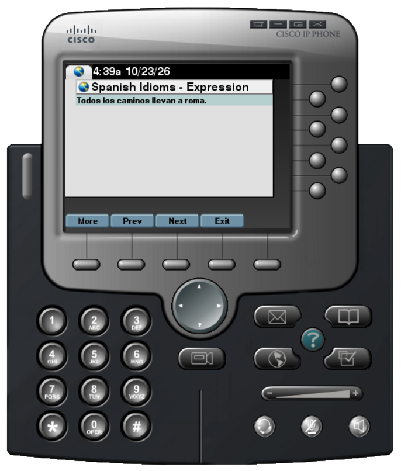

# Spanish Idioms

  

Spanish idioms are non-literal, everyday phrases whose figurative meaning cannot be guessed just by looking at the definitions of the individual words.

Native speakers use idioms constantly in daily conversation, film, TV, social media, etc. Missing them can lead to confusion or misunderstanding literal translations. Recognizing and using common expressions helps you connect easily with native speakers and feel more at home in Spanish-speaking environments.

Here are a few examples...

Idiom | Meaning
:-- | :--
Cuando se cierra una puerta, se abre una ventana. | Where one door closes, another one opens.
Cada una tiene lo que se merece. | People get what they deserve.
La curiosidad mato al gato. | Curiosity killed the cat.

